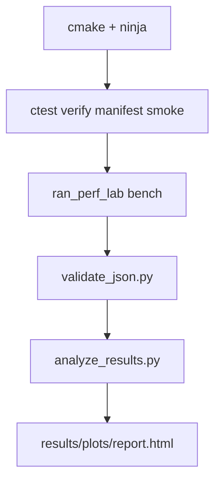
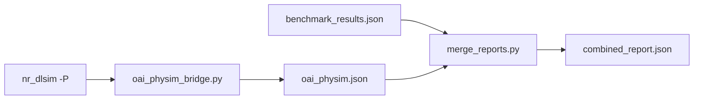

# ran-perf-lab

Standalone **C11** benchmark harness for PHY-style DSP kernels: deterministic inputs, platform manifest, JSON results, CI scripts, and HTML reports. It practices the same habits you need when working with large RAN codebases (fixed commands, recorded environment, machine-readable output).

Optional tooling parses **OpenAirInterface** physical simulator (`nr_dlsim` / `nr_ulsim`) `-P` timing lines and merges them with lab JSON. This repository is **independent** of any upstream RAN project; it is a personal engineering lab.

## What this project does

| Area | Behavior |
|------|----------|
| **Correctness** | Scalar vs SIMD paths for the same math; `verify` fails if they diverge beyond tolerance. |
| **Timing** | `CLOCK_MONOTONIC_RAW`, warmup + timed iterations, mean/stdev/min/max in nanoseconds. |
| **Environment** | `manifest` captures CPU, memory, kernel, compiler, and SIMD backend names from `/proc` and the build. |
| **Automation** | CMake + CTest, `ci_local.sh`, GitHub Actions, Docker, optional Kubernetes Job. |
| **Reporting** | JSON schema `ran_perf_lab/2`, validation script, bar charts and `report.html`. |
| **OAI hook** | Optional bridge reads physim logs into `ran_perf_lab_oai_physim/1` JSON and merges reports. |

## Kernel map (PHY intuition)

| Kernel | Role in a RAN PHY mental model | SIMD backend (x86 with AVX2) |
|--------|-------------------------------|--------------------------------|
| `dot_real` | Correlation / matched filter building block | AVX2 FMA |
| `dot_cplx_conj` | Channel estimation style multiply-accumulate with conjugate | AVX2 FMA complex |
| `channel_energy` | RSSI / symbol power (\|x\|² sum) | AVX2 FMA complex |
| `phase_rotate` | CFO or phase compensation on a buffer | SSE128 complex pair |

OAI uses similar dot-product ideas under `openair1/PHY/TOOLS` (different types and integration). This lab isolates kernels so you can tune and measure without a full stack build.

## Architecture

```
                    ┌─────────────────────────────────────┐
                    │           ran_perf_lab              │
                    │  (verify | bench | manifest)        │
                    └──────────────┬──────────────────────┘
                                   │
         ┌─────────────────────────┼─────────────────────────┐
         ▼                         ▼                         ▼
   ┌───────────┐           ┌───────────────┐         ┌──────────────┐
   │ CTest     │           │ JSON files    │         │ manifest.json │
   │ verify    │           │ schema v2     │         │ host metadata │
   │ smoke     │           │ benchmarks[]  │         └──────────────┘
   └───────────┘           └───────┬───────┘
                                     │
                    ┌────────────────┼────────────────┐
                    ▼                ▼                ▼
            validate_json.py   analyze_results.py   merge_reports.py
                    │                │                │
                    └────────────────┴────────┬────────┘
                                              ▼
                                    results/plots/report.html
                                    results/benchmark_results.json
```

### End-to-end flow (local CI)



### Optional OpenAirInterface path

When `OAI_BUILD` points at a directory containing `nr_dlsim`:



## Repository layout

```
.
├── CMakeLists.txt
├── include/           Public headers and schema macros
├── src/               CLI, kernels, bench, manifest
├── python/            validate, analyze, merge, OAI bridge
├── scripts/           ci_local, perf wrapper, flag comparison, OAI runners
├── .github/workflows/ CI on push
├── Dockerfile
├── docker-compose.yml
├── k8s/job.yaml       Optional batch job manifest
└── results/           Generated locally (gitignored except .gitignore)
```

## Requirements

- Linux (developed on Ubuntu)
- CMake 3.16+, Ninja or Make, GCC or Clang with AVX2 for full SIMD paths
- Python 3.10+ with `matplotlib` for plots (see `requirements.txt`)
- Optional: `perf`, Docker, kubectl

## Build

```bash
git clone https://github.com/Jay2006sawant/perf-lab.git
cd perf-lab
mkdir -p build && cd build
cmake .. -GNinja
ninja
```

Disable host-specific tuning for portable binaries:

```bash
cmake .. -GNinja -DRAN_PERF_LAB_NATIVE=OFF
```

## Run

### Correctness

```bash
./build/ran_perf_lab verify
```

### Platform manifest

```bash
./build/ran_perf_lab manifest --output results/platform_manifest.json
```

### Benchmark suite (JSON)

```bash
./build/ran_perf_lab bench --iterations 50 --warmup 10 --seed 42 \
  --output results/benchmark_results.json
```

Use `--noise-floor` to subtract an empty-loop timing estimate from reported means.

### Full local pipeline (recommended)

```bash
./scripts/ci_local.sh
```

This builds (if needed), runs CTest, validates JSON, writes plots and **`results/plots/report.html`**.

Other scripts:

| Script | Purpose |
|--------|---------|
| `scripts/compare_build_flags.sh` | `-O2` vs `-march=native` JSON under `results/compare_flags/` |
| `scripts/run_with_perf.sh` | Wraps a command with `perf stat` when installed |
| `scripts/run_oai_bridge.sh` | Runs physim + bridge when `OAI_BUILD` is set |
| `scripts/run_full_portfolio.sh` | Lab bench plus OAI bridge and merge |
| `scripts/ci_in_container.sh` | CI entry used inside Docker |

## Outputs

| File | Description |
|------|-------------|
| `build/manifest.json` | CTest-generated manifest during smoke runs |
| `build/smoke_bench.json` | Short benchmark from CTest |
| `results/benchmark_results.json` | Full suite, schema `ran_perf_lab/2` |
| `results/platform_manifest.json` | Host snapshot when written by scripts |
| `results/plots/report.html` | HTML report with speedup bar chart per kernel |
| `results/plots/SUMMARY.md` | Text summary of speedups |
| `results/plots/*.png` | Kernel plots when matplotlib saves figures |
| `results/oai_physim.json` | Parsed physim `-P` metrics (optional) |
| `results/combined_report.json` | Merged lab + OAI JSON (optional) |
| `results/perf_verify.stat` | Optional `perf stat` from CI |

### JSON benchmark shape (schema `ran_perf_lab/2`)

- `config`: `warmup`, `iterations`, `seed`, noise-floor flag  
- `noise_floor_ns`: empty-loop timing when enabled  
- `backends`: SIMD implementation names per kernel family  
- `benchmarks[]`: one row per kernel with `scalar` and `vectorized` objects (`mean_ns`, `stdev_ns`, `min_ns`, `max_ns`, `samples`)

Validated by `python/validate_json.py` in CI.

## Docker and Kubernetes

```bash
docker compose build
docker compose run --rm perf-lab
```

For Kubernetes, build and tag the image, edit `k8s/job.yaml` if needed, then:

```bash
kubectl apply -f k8s/job.yaml
```

## OpenAirInterface integration (optional)

This lab does not vendor OpenAirInterface. If you already built physim binaries:

```bash
export OAI_BUILD=/path/to/openairinterface5g/build
./scripts/run_oai_bridge.sh
```

The bridge runs a short `nr_dlsim` / `nr_ulsim` invocation, parses `time_meas` style lines from stdout, and writes `results/oai_physim.json`. `merge_reports.py` can combine that with `benchmark_results.json`.

Example physim command (matches common KPI style documentation):

```bash
cd "$OAI_BUILD"
./nr_dlsim -n200 -s20 -S20.2 -e15 -b106 -R106 -P
```

## Continuous integration

GitHub Actions (`.github/workflows/ci.yml`) runs the same steps as `ci_local.sh` on push.

## Skills this repo exercises (reviewer checklist)

| Topic | Where in the repo |
|--------|-------------------|
| SIMD intrinsics | `src/dotproduct.c`, `cplx_dot.c`, `phaserot.c`, `inspect_simd_asm.sh` |
| Compiler flags | `compare_build_flags.sh`, `RAN_PERF_LAB_NATIVE` CMake option |
| Linux tuning context | `cpufreq_governor` in manifest JSON, `capture_host_tuning.sh` |
| perf | `ci_local.sh`, `run_with_perf.sh`, optional `run_flamegraph.sh` |
| 5G / PHY intuition | `docs/WIRELESS.md`, OAI optional bridge |
| Cross-run comparison | `compare_json_runs.py` (two JSON files, percent delta) |
| Docker / Kubernetes | `Dockerfile`, `docker-compose.yml`, `k8s/job.yaml` |

Not included: Tracy, VTune, DPDK, PREEMPT_RT, CUDA (use full OAI tree for those when needed).

## Methodology notes

1. **Verify before timing** so SIMD paths cannot drift from scalar reference.  
2. **Warmup** before timed iterations to reduce cold-cache bias.  
3. **Fixed seed** for reproducible inputs across runs.  
4. **Record the platform** (manifest) whenever you publish numbers.  
5. **Compare compiler flags** on the same host before trusting `-march=native` speedups.

For CPU governor and isolation, record `cpupower`, `scaling_governor`, and kernel cmdline in your lab notebook when numbers go into a report.

## License

Source files use **SPDX-License-Identifier: CC-BY-4.0** unless otherwise marked in the file header.

## Author

Jay Sawant · [github.com/Jay2006sawant](https://github.com/Jay2006sawant)
